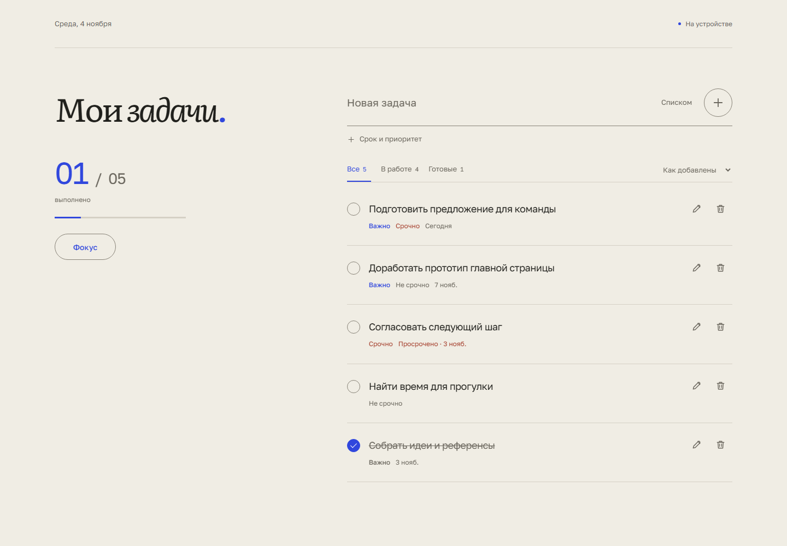

# Мои задачи

Небольшой личный список задач на React, TypeScript и Vite.

[Открыть сайт](https://denispvx.github.io/todo-list/)

Добавляйте задачи, отмечайте выполненные и удаляйте ненужные. Текст, порядок и статусы сохраняются после обновления страницы. Интерфейс работает на телефоне и поддерживает управление с клавиатуры.

- **Фокус** — одна задача и необязательный таймер на 25 минут. Пауза и оставшееся время сохраняются; закрытие экрана не останавливает отсчёт. Завершение таймера не отмечает задачу выполненной.
- **Списком** — вставьте многострочный план и проверьте предпросмотр. До 50 задач за один раз; маркеры Markdown и нумерация убираются. Многострочная вставка в обычное поле тоже открывает предпросмотр.
- **Отмена удаления** — кнопка «Вернуть» восстанавливает последнюю удалённую задачу с прежним статусом и местом. Уведомление не исчезает по таймеру; история отмены действует до закрытия уведомления или обновления страницы. Ctrl/⌘ Z вне полей ввода тоже возвращает задачу.
- **Редактирование** — кнопка с карандашом открывает название на месте. Enter сохраняет, Escape отменяет.
- **Фильтры** — «Все», «В работе» и «Готовые» меняют отображение. Прогресс всегда относится ко всему списку.
- **Планирование** — «Важно», срочность и срок задаются независимо через «Срок и приоритет» при создании или через карандаш у задачи. Дату можно убрать. Просроченные незавершённые задачи обозначены текстом.
- **Порядок** — «Как добавлены», «Сначала важные» или «По сроку». Сначала важные группирует по важности, затем по срочности внутри каждой группы. По сроку показывает ранние даты первыми, задачи без срока — последними. Сортировка меняет только вид; после перезагрузки возвращается исходный порядок.



## Запуск

Нужны Node.js 24 LTS (не ниже 24.15) и npm.

```sh
npm ci
npm run dev
```

Откройте адрес из терминала с путём `/todo-list/`.

## Проверки

```sh
npm run lint
npm run typecheck
npm run test:run
npm run build
npx playwright install chromium
npm run test:e2e
```

`npm run preview` запускает локальную production-сборку. Это проверочный сервер, не хостинг.

## Устройство проекта

- `src/features/tasks/model.ts` — модель, валидация ввода и контракт хранения.
- `src/features/tasks/contracts.ts` — props компонентов.
- `src/features/tasks/reducer.ts` — чистые операции со списком.
- `src/features/tasks/storage.ts` — проверка и сохранение данных.
- `src/features/tasks/useTasks.ts` — управление состоянием и хранением.
- `src/features/tasks/batch.ts` — разбор многострочного плана.
- `src/features/tasks/planning.ts` — календарные даты, валидация параметров и стабильная сортировка.
- `src/features/tasks/components/` — форма, список и состояния интерфейса.
- `src/features/focus/` — экран фокуса и сохраняемый таймер.
- `src/app/App.tsx` — композиция интерфейса.
- `src/styles/` — токены и адаптивные стили.
- `tests/`, `e2e/` — проверки контрактов и production-сборки.

Подробнее: [контракты](docs/contracts.md), [визуальное направление](docs/design.md).

Шрифты Literata и Golos Text размещены локально; [лицензии и источники](public/fonts/README.md) включены в репозиторий.

## Публикация

Проект размещается на GitHub Pages по пути `/todo-list/`. Workflow проверяет pull requests без публикации. Успешный push в main публикует ту же сборку, которая прошла тесты. Ручной запуск доступен через `Quality and Pages` с `deploy=true`. Секреты и платные сервисы приложению не нужны.

Задачи хранятся в localStorage текущего браузера для текущего адреса сайта. Приложение не отправляет их на сервер. Синхронизация устройств и одновременных изменений нескольких вкладок не предусмотрена; последняя успешная запись побеждает. Очистка данных браузера удаляет список, а в приватном режиме данные могут исчезнуть после закрытия сессии.

Срок — календарный день в местном часовом поясе, без времени и push-напоминаний. Дата в шапке и подписи сроков обновляются при смене дня и возвращении к странице. Прежние задачи без параметров загружаются как раньше.

Если браузер запрещает хранение или запись не удалась, список продолжит работать в памяти с предупреждением. Повреждённые данные не перезаписываются автоматически: их можно явно заменить текущим списком через кнопку в уведомлении.

## AI-инструменты

Использовал Codex для проработки архитектуры, реализации интерфейса и хранения данных, а также подготовки проверок и независимого разбора дизайна. Автотесты покрывают ввод, операции со списком, ошибки хранилища, фокус, пакетное добавление и восстановление после обновления страницы.
